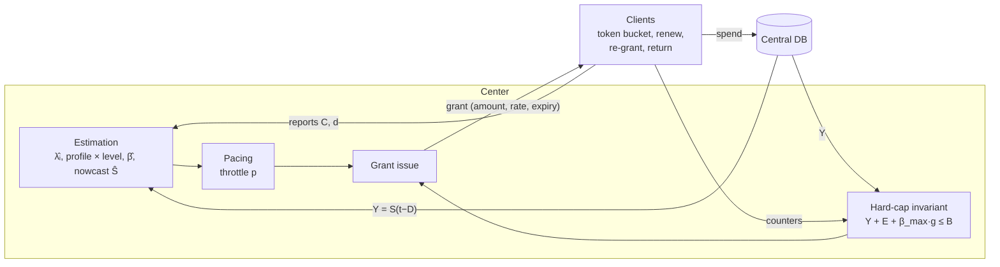
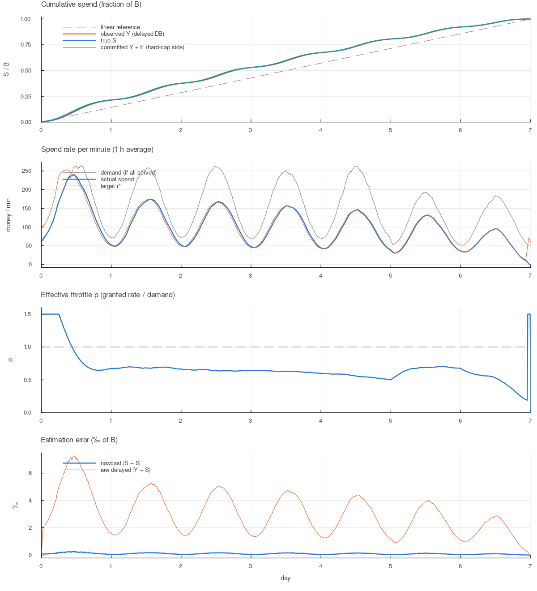

# Budget pacing with delayed spend data: model, strategies, results

## 1. Problem

A **center** must spend a budget $B$ during a period $T$.

- $B$ is a **hard cap**: the true spend must never exceed it. Underspend is undesirable but allowed.
- Spending is done by **clients**. A client may spend only from a live **grant** issued by the center. A grant is a small local budget with a pacing rate and an expiry time.
- Client demand is random: a mean rate with Gaussian noise, and daily and weekly patterns **that are not known in advance**. Total demand is usually, but not always, larger than $B/T$.
- The authoritative spend comes from a **central database**. It is visible only after a delay $D$, and it is **not** the sum of what clients count (fees, rounding, currency effects and so on).
- Clients send fast but non-authoritative usage reports, and they can return unused grant amounts early.

The design problem: choose grant sizes, rates and expiries so that the budget is spent as fully and
smoothly as possible, without ever exceeding $B$, while the true state is only seen with a delay.

## 2. Notation

| Symbol | Meaning |
|---|---|
| $S(t)$ | true cumulative spend in the DB |
| $Y(t) = S(t - D)$ | value the center observes |
| $C_i(t)$ | cumulative spend counted by client $i$ (reported, lag ≈ 1 min) |
| $\beta$ | DB amount per client-counted unit ($\Delta S \approx \beta \Delta C$), unknown, $\beta \le \beta_{max}$ |
| $D_{max}$ | upper bound of the DB delay used for safety |
| $d_i(t)$ | demand of client $i$: what it *would* spend without limits |
| $\hat\lambda_i$ | center's estimate of client $i$'s demand rate |
| $p$ | throttle: granted rate / estimated demand |
| $\tau$ | grant duration |
| $E$ | exposure: spend that open grants may still add to the DB beyond $Y$ |
| EWMA | Exponentially Weighted Moving Average (see below) |

**EWMA (Exponentially Weighted Moving Average).** A running average in which recent values count more than older ones. Each new observation $x$ moves the estimate a fraction $\alpha$ of the way toward it:

```math
\hat x \leftarrow \hat x + \alpha\,(x - \hat x), \qquad \alpha = \frac{\Delta t}{\text{window}}
```

Expanded, $\hat x$ is a weighted sum of all past values. A value of age $a$ has weight $\approx \alpha e^{-a/\text{window}}$: one window back it counts 37 % as much as the latest value, three windows back about 5 %. The *window* is the estimate's effective memory. A short window reacts fast but is noisy; a long one is smooth but slow.

An EWMA needs one stored number per estimate. It is also what a Kalman filter becomes in steady state for a "slowly drifting level + noise" model.

Used in the simulator:

| Estimate | Window |
|---|---|
| per-client demand $\hat\lambda_i$ (center), client's own demand (client side) | 30 min |
| $\hat\beta = \text{EWMA}(\Delta Y) / \text{EWMA}(\Delta C)$ | 4 h |
| demand level vs learned profile | 4 h |
| long-run total demand (fallback for unseen profile bins) | 1 day |

## 3. World model (what the simulator generates)

Time step $\Delta t = 1$ min. The period is one week and starts on Monday 00:00, so the weekend is the **last** two days.

**Demand.** Client $i$ has a size $\mu_i$ (lognormal across clients, $\sigma = 0.8$), normalized so that
total mean demand is `demand_ratio` $\times B/T$. Its demand in one step is

```math
d_i = \max\Big(0,\; m_i\Delta t + \text{cv}\cdot m_i\sqrt{\Delta t}\,\xi\Big),\qquad
m_i(t) = \mu_i \cdot P(t+\phi_i)\cdot \text{shock}(t)\cdot e^{x_i(t)-\sigma_x^2/2}
```

- $P(t) = \big(1 + a_d \sin(2\pi t/\text{day} - \pi/2)\big)\cdot(1 - a_w\ \text{on weekends})$, normalized to mean 1. The trough is at midnight. Defaults: $a_d = 0.6$, $a_w = 0.3$.
- $\phi_i$ is a per-client phase shift (std 60 min).
- $x_i$ is a slow Ornstein–Uhlenbeck drift (std 0.15, correlation time 6 h; see below). In the "volatile" scenario: std 0.8, correlation time 2 h.
- $\xi \sim N(0,1)$, with cv = 0.5 per minute.
- An optional *shock* multiplies demand by a factor inside a time window.

**Ornstein–Uhlenbeck (OU) drift.** An OU process is a *mean-reverting random walk*. It wanders
randomly, but is always pulled back toward its mean (here 0):

```math
dx = -\frac{x}{\theta}\,dt + \sigma\sqrt{\frac{2}{\theta}}\;dW
```

The first term pulls $x$ back to 0, harder the further away it is. The second term is random
Brownian kicks ($dW$). Two parameters define it:

- $\sigma$ sets **how far** it wanders. In steady state $x \sim N(0, \sigma^2)$, so its range is bounded on average.
- $\theta$ (correlation time) sets **how slowly** it moves. The correlation between $x(t)$ and $x(t+\Delta)$ is $e^{-\Delta/\theta}$: after one $\theta$ it is 0.37, after $3\theta$ it is about 0.05.

It sits between the two simpler noise models:

| model | memory | range | as client demand |
|---|---|---|---|
| white noise (the per-minute $\xi$) | none | bounded | minute-to-minute jitter that averages out quickly |
| random walk (Brownian motion) | infinite | grows as $\sqrt{t}$, unbounded | a client could drift to ×100 or ×0.01 by the end of the week, which is unrealistic |
| **OU** | about $\theta$ | bounded, std $\sigma$ | a client is "busier" or "quieter" for a few hours, then returns to normal |

It models real effects such as a client's campaign or traffic source running hot or cold for a while.
These are slow deviations that the center's 30 min demand estimate can follow, unlike the per-minute noise.

It enters demand **multiplicatively** as $e^{x - \sigma^2/2}$. The exponential keeps demand positive.
The $-\sigma^2/2$ term makes the factor's mean exactly 1, so drift changes *when* a client spends, not its total demand.
Typical (±1σ) ranges of the factor:

- default ($\sigma = 0.15$, $\theta = 6$ h): 0.85 – 1.15, changing over hours;
- volatile ($\sigma = 0.8$, $\theta = 2$ h): 0.33 – 1.62, so a client's demand can triple or drop by two thirds within an afternoon.

The simulator steps it with the Euler–Maruyama scheme
`x += -x·dt/θ + σ·sqrt(2·dt/θ)·randn()` (`src/simulate.jl`). This is accurate because
$dt = 1$ min $\ll \theta$ (the exact update $x e^{-dt/\theta} + \sigma\sqrt{1-e^{-2dt/\theta}} \xi$
differs by < 0.5 %). The initial value is drawn from the
stationary distribution $N(0,\sigma^2)$, so there is no warm-up transient.

**DB.** Each unit a client spends is recorded as $\beta(1+\varepsilon)$ with $\beta = 1.02$ and
$\varepsilon \sim N(0, 0.01^2)$ clipped at ±3σ. The center sees $Y(t) = S(t - D - j)$, where
$j \sim U[0, D_{jitter}]$ and the observed time never goes backwards.

**Reports.** Clients report cumulative counted spend and demand, with a 1 min lag.

## 4. System design



The center has two **independent** mechanisms:

1. **The hard-cap invariant** stops overspend. It uses no estimates, only bounds.
2. **The pacing controller** stops underspend and keeps delivery smooth. It is statistical and may be wrong without affecting safety.

### 4.1 Hard-cap invariant

For every grant $k$ not yet settled, the center computes an upper bound on DB spend it may still add beyond $Y$.
Let $s = t - D_{max}$, the latest time surely included in $Y$, and let $u_k(s)$ be what the client counted on grant $k$ up to $s$:

```math
e_k = \beta_{max}\cdot
\begin{cases}
\text{amount}_k - u_k(s) & \text{grant still in use}\\
u_k^{final} - u_k(s) & \text{grant returned or expired}
\end{cases}
\qquad E = \sum_k e_k
```

A new grant $g$ is issued only if $Y + E + \beta_{max} g \le B(1-\delta)$, and it may be cut down to fit.

*Why this is safe:* future DB spend comes only from existing grants (bounded by $E$) and new grants (checked when issued).
When money is spent, $Y$ grows by at most what $E$ shrinks, so $Y + E$ never increases between issues and $S(T) \le B$.
This holds **if** the true delay is at most $D_{max}$ and the true DB/client ratio is at most $\beta_{max}$ (see §6.G).
Variant `exposure_mode = :full` does not trust client counters and always counts the full grant amount.

### 4.2 Estimation

| Quantity | Estimator |
|---|---|
| client demand $\hat\lambda_i$ | EWMA (30 min) of reported demand. Demand is reported even while the client is throttled, so the estimate is unbiased. |
| daily profile | 96 bins of 15 min; each new day's average is blended in with weight 0.5 |
| level | EWMA (4 h) of current total demand / profile value. This catches the unknown **weekly** effect. |
| $\hat\beta$ | $\text{EWMA}(\Delta Y) / \text{EWMA}(\Delta C)$ over 4 h, with $C$ aligned by the assumed delay |
| nowcast | $\hat S(t) = Y(t) + \hat\beta [C(t) - C(t-D)]$ |

The nowcast has the structure of a **Smith predictor** (delayed truth plus the change of a fast signal over the delay window). The fast signal, however, is *measured* client spend rather than a model driven by the control input, so it is closer to sensor fusion. A Kalman filter on $[S, \dot S]$ would be the natural extension when client reports are lost, or when $D$ varies a lot.

### 4.3 Pacing law

Each minute the center computes a **target spend rate** $r^*$ (DB units per minute) from:

- $R = B(1-\delta) - \hat S$: the remaining budget, using the nowcast $\hat S$;
- $T_{plan} = T - \text{buffer}$: the center plans to be done this much before $T$;
- $h_c$ (`forecast_haircut`): the center plans as if future demand will be this fraction lower than forecast.

**Uniform:** spread the remaining budget evenly over the remaining planning time:

```math
r^*_{uniform} = \frac{R}{(1-h_c)\,(T_{plan}-t)}
```

**Adaptive:** give the current minute the same share of the remaining budget as its share of the remaining expected demand:

```math
r^*_{adaptive} = R \cdot \frac{\hat\Lambda_{now}}{(1-h_c)\,\hat\Lambda(t, T_{plan})},
\qquad
\hat\Lambda(t, T_{plan}) = \int_t^{T_{plan}} \text{level}\cdot\text{profile}(s)\,ds
```

Here $\hat\Lambda_{now} = \sum_i \hat\lambda_i$ is the current total demand rate, and $\hat\Lambda(t, T_{plan})$ is the total demand expected until $T_{plan}$. In effect, *the throttle stays constant and money is spent when the demand is there*.

The factor $1/(1-h_c)$ makes both rates slightly higher than needed, so the center runs a little ahead of plan (see *Forecast haircut* below).

Inside the buffer ($t > T_{plan}$), $r^* = \infty$: serve all demand and let the hard cap stop it.

**Throttle and client rate.** $R$ and $r^*$ are in DB units, while demand is in client units, so the center converts with $\hat\beta$:

```math
p = \frac{r^*}{\hat\beta \sum_i \hat\lambda_i},
\qquad
\text{rate}_i = \min(p,\ 1+h)\cdot\hat\lambda_i, \quad h = 0.5
```

(An earlier version omitted $\hat\beta$ here. The β sensitivity sweep in §6.H found the error: results depended on the level of $\beta$.)

#### Forecast haircut

The **haircut** $h_c$ (`forecast_haircut`, default 0.2) is deliberate pessimism. When planning, the center assumes future demand will be $h_c$ lower than its forecast. The term comes from finance, where a *haircut* means valuing an asset below its estimate for safety.

It enters the throttle as

```math
p = \frac{R}{\hat\beta\,(1-h_c)\,\hat\Lambda(t, T_{plan})}
```

Example: remaining budget $R$ = 100k, forecast remaining demand worth 200k (in DB units):

| | assumed remaining demand | throttle $p$ |
|---|---|---|
| no haircut | 200k | 0.50 |
| haircut 0.2 | 160k | 0.625 |

The center therefore lets clients spend about 25 % faster than an exact plan.

**It does not simply spend 25 % too much.** The plan is recomputed every minute. Faster spending shrinks $R$ faster, and that lowers $p$ again. The net effect is a spend curve that stays *ahead* of the exact plan, so the budget runs out somewhat before $T$: about 2.6 h early in the baseline (§6.B). The hard cap stops spending at $B$, so the haircut can never cause overspend.

**Why be pessimistic?** The two kinds of error are not symmetric:

- **Ahead of plan:** fixable. The center can always throttle later.
- **Behind plan:** may not be fixable. If demand drops near the end (a quiet weekend night, a sudden shock), the remaining money cannot be spent in the time left.

The haircut is insurance against the second case. The premium is finishing early.

**Haircut vs finish buffer.** Both are planning margins:

- The **finish buffer** moves the planned end *in time* ("be done 1 h early"). It is blunt: a 6 h buffer costs a 6 h idle tail in every run.
- The **haircut** shrinks the *expected demand*. It spreads the caution over the whole period and adapts to how much demand there is. For the same idle tail it protects better against late demand drops (§6.B).

**Choosing it.** It is a business setting that weighs an early finish against underspend:

| haircut | spend if demand drops to 30 % in the last 12 h | budget gone before $T$ (baseline) |
|---|---|---|
| 0 (and no buffer) | 95.8 % | 0.6 h |
| 0.05 | 96.9 % | 1.7 h |
| 0.1 | 97.8 % | 2.0 h |
| **0.2 (default)** | **99.1 %** | **2.6 h** |
| 0.3 | 99.99 % | 3.6 h |

(Rows from 0.05 to 0.3 also use the 1 h finish buffer.)

- ≈ 0.3 if late demand drops are common;
- 0.05–0.1 if spending must last until $T$;
- 0.2 as a middle ground.

A haircut that shrinks toward $T$ would reduce front-loading while keeping late protection (§8).

Both margins follow the same asymmetry: **being ahead can be corrected by throttling, but being behind may be impossible to recover** if demand runs out.

### 4.4 Grants and client behaviour

| Element | Rule (default) |
|---|---|
| duration | $\tau = \text{clamp}(0.01 (T-t),\ 5,\ 60)$ min, so grants shrink near the end; expiry ≤ $T$ |
| amount | rate × τ, cut down by the hard cap; grants below 1 unit are not issued |
| local pacing | token bucket at the grant rate, size = 5 min of rate. The client **never spends a grant at once**, even if it has the demand. |
| renewal | ask for the next grant when < 3 min or < 3 min of rate is left (delivery latency 1 min) |
| re-grant | ask for a new grant when own demand has risen > 30 % above what the grant was sized for |
| partial return | keep at most 2 × expected use until expiry and return the rest (rate unchanged) |
| replacement | a new grant replaces the old one; with returns, the old unused part is freed at once, otherwise only at its expiry |

### 4.5 Feasibility alert

After day 1, raise an alert when $\hat\beta \hat\Lambda(t, T) < R$, i.e. the expected remaining demand cannot fill the remaining budget. Remaining budget below 0.1 % of $B$ is ignored.

## 5. Simulation setup

Defaults: $B = 10^6$, $T$ = 7 days, 50 clients, demand ratio 1.5, $D$ = 30 min, $\beta_{max}$ = 1.06, $D_{max} = D + D_{jitter}$.
Each configuration is run with 40 random seeds.

Metrics:

- **spend %**: $S(T)/B$, mean and worst run
- **runs over B**: must be 0
- **grants/min**: center load
- **util %**: client spend / granted amount
- **Ŝ err / Y err**: mean $|\hat S - S|/B$ and $|Y - S|/B$, in ‰
- **done before T**: how early 99.9 % of $B$ was reached. A large value means an idle tail.
- **alert runs**: runs in which the feasibility alert fired



*Baseline run (seed 1).*

- Cumulative spend runs ahead of the linear reference: this is the planning margin.
- Spend follows demand at a nearly constant throttle $p \approx 0.6$.
- During the weekend the level factor raises $p$.
- The nowcast error is ~30× smaller than that of the raw delayed $Y$ (0.10 ‰ vs 3.0 ‰ of $B$).
- On day 1 the center has no profile yet, so the throttle is at its maximum: this is a learning period.

## 6. Strategies and results

Cells in cross tables: **mean % / worst % of B spent** over 40 runs. In every configuration
with valid safety assumptions, **no run exceeded B**.

### A. Pacing strategy

| variant | baseline | demand ×1.15 | day-4 shock 20% | last-12h shock 30% | demand ×0.9 |
|---|---|---|---|---|---|
| uniform | 100.00 / 100.00 | 98.22 / 97.47 | 99.72 / 99.46 | 97.71 / 97.45 | 87.61 / 86.48 |
| adaptive, no level factor | 100.00 / 100.00 | 100.00 / 100.00 | 100.00 / 100.00 | 97.37 / 97.05 | 92.02 / 89.93 |
| **adaptive (default)** | 100.00 / 100.00 | 100.00 / 100.00 | 100.00 / 100.00 | 99.14 / 98.98 | 92.02 / 89.94 |
| uniform, no margin | 97.59 / 97.23 | 91.47 / 90.69 | 94.11 / 93.31 | 92.57 / 92.21 | 81.98 / 81.06 |
| adaptive, no margin | 100.00 / 100.00 | 97.74 / 97.22 | 98.56 / 97.98 | 95.82 / 95.60 | 89.21 / 87.96 |

- **Uniform pacing** (same rate at all times) fights the demand pattern. It throttles at peaks and cannot reach the target in troughs. Without a margin it underspends even in the baseline (97.6 %), because the period ends on a low-demand weekend night.
- **Adaptive pacing** spends in proportion to expected demand and is better in every scenario.
- **The level factor** matters when the forecast is wrong late in the period. The profile is learned on weekdays, but the period ends on a weekend, and in the late-shock case demand drops further. Without the level factor the center keeps expecting demand that never comes (97.4 % vs 99.1 %).
- **When demand is below the budget** (×0.9), the best possible is ~92 % (all demand served). Adaptive reaches it, uniform loses 4.4 points more, and the alert fired in every run.

### B. Planning margin (finish buffer, forecast haircut)

| variant | baseline | demand ×1.15 | last-12h shock 30% |
|---|---|---|---|
| none | 100.00 / 100.00 | 97.74 / 97.22 | 95.82 / 95.60 |
| buffer 6 h | 100.00 / 100.00 | 99.39 / 98.84 | 97.85 / 97.66 |
| 1 h + haircut 0.05 | 100.00 / 100.00 | 99.49 / 99.02 | 96.94 / 96.72 |
| 1 h + haircut 0.1 | 100.00 / 100.00 | 100.00 / 100.00 | 97.77 / 97.56 |
| **1 h + haircut 0.2 (default)** | 100.00 / 100.00 | 100.00 / 100.00 | 99.14 / 98.98 |
| 1 h + haircut 0.3 | 100.00 / 100.00 | 100.00 / 100.00 | 99.99 / 99.92 |

Hours before $T$ at which 99.9 % of $B$ was spent (– = never):

| variant | baseline | demand ×1.15 | last-12h shock 30% |
|---|---|---|---|
| none | 0.6 | – | – |
| buffer 6 h | 6.2 | 0.6 | – |
| 1 h + haircut 0.05 | 1.7 | 0.4 | – |
| 1 h + haircut 0.1 | 2.0 | 1.9 | – |
| 1 h + haircut 0.2 | 2.6 | 2.5 | – |
| 1 h + haircut 0.3 | 3.6 | 3.5 | 1.2 |

This is the main **business trade-off**. A margin is insurance against demand disappearing late in the period. Its cost is
front-loaded spending and an idle tail (the budget is gone 2–4 h before $T$).

- A pure time buffer is a blunt tool: 6 h of idle tail in the baseline.
- The haircut buys more robustness per hour of idle tail.
- 0.2 is a reasonable default. Use 0.3 if late demand drops are common, and 0.05–0.1 if an early finish is costly.

### C. Grant duration τ

| variant | spend mean % | grants/min | util % | done before T (h) |
|---|---|---|---|---|
| τmax = 15 min | 100.000 | 4.56 | 82.9 | 2.6 |
| **τmax = 60 min (default)** | 100.000 | 2.38 | 89.9 | 2.6 |
| τmax = 240 min | 100.000 | 2.30 | 88.6 | 2.6 |
| τ = 240 fixed | 100.000 | 0.32 | 70.5 | 5.1 |
| volatile, τmax = 15 | 100.000 | 4.59 | 76.4 | 2.4 |
| volatile, τmax = 60 | 100.000 | 2.59 | 66.0 | 2.4 |
| volatile, τ = 240 fixed | 100.000 | 0.55 | 33.6 | 6.3 |

- With re-grants and returns in place, τ hardly affects total spend. It sets **center load** (grants/min) and **endgame granularity**.
- Short grants cost requests.
- Long fixed grants reserve big amounts near the end, so the cap closes early (idle tail 5–6 h) and much granted money comes back unused (util 33–70 %).
- The default τ shrinks as $T$ approaches: about 1 grant per client per 20 min, while keeping the endgame fine-grained.

### D. Client behaviour: re-grant and return

| variant | volatile, τ=240 | 5 volatile, τ=240 | volatile, demand ×1.2 | last-12h shock 30% |
|---|---|---|---|---|
| **re-grant + partial return (default)** | 100.00 / 100.00 | 100.00 / 99.98 | 99.66 / 97.61 | 99.14 / 98.98 |
| no partial return | 100.00 / 100.00 | 100.00 / 99.89 | 99.66 / 97.61 | 99.14 / 98.98 |
| no re-grant | 95.71 / 93.30 | 93.20 / 85.98 | 98.16 / 94.92 | 99.13 / 98.97 |
| no return at all | 99.98 / 99.95 | 99.74 / 98.67 | 99.66 / 97.61 | 99.14 / 98.98 |

**Re-grant** is the most important client behaviour. A grant's rate is fixed when it is issued. If a client's demand jumps, it stays limited until expiry, which means hours with long grants. Without re-grant, the worst run spends only 86 %.

**Why early return matters.** Every unused amount of an open grant counts against $B$ until the center can prove it was not spent: at return, or else at expiry plus the DB delay. Return therefore matters only when the cap **binds**, i.e. at the end of the period. It matters more when grants are large relative to the budget: with 5 large clients the worst run goes from 98.67 % to 99.98 %.

It also makes re-grants cheap. Without return, every re-grant reserves twice.

*Partial return* (shrinking a grant the client cannot use) had only a small effect (worst run 99.89 % → 99.98 % with 5 large clients). It is kept because it is cheap and helps when one client's demand collapses mid-grant.

An earlier version shrank the *rate* on a demand drop and reset the token bucket. That **lowered** spend (95.0 % vs 98.0 % without any return, for volatile clients with τ = 240 and a last-12h drop to 20 %, measured with the earlier 6 h buffer and no haircut), because a smaller rate captures less of noisy demand. Return the amount, not the rate.

### E. Exposure accounting

| variant | baseline | volatile, τ=240 | 5 volatile, τ=240 |
|---|---|---|---|
| **reported counters (default)** | 100.00 / 100.00 | 100.00 / 100.00 | 100.00 / 99.98 |
| full grant amounts | 100.00 / 100.00 | 99.94 / 99.87 | 99.93 / 99.72 |

Counting the full amount of every open grant ignores client counters, so it is safe even if the counters are wrong. It ties up more headroom at the end and costs ~0.05–0.3 % of $B$. The counters can be trusted for the *limit*, because the client enforces the grant with that same counter. What is inaccurate is only the mapping from counter to DB amount, and $\beta_{max}$ covers that.

### F. Delay compensation (nowcast vs pacing on raw Y)

| variant | spend mean % | grants/min | Ŝ err ‰ | Y err ‰ | done before T (h) | alert runs |
|---|---|---|---|---|---|---|
| D = 30, nowcast | 100.000 | 2.38 | 0.099 | 2.976 | 2.6 | 0 |
| D = 30, pace on Y | 100.000 | 2.30 | 2.976 | 2.976 | 3.7 | 0 |
| D = 120, nowcast | 99.998 | 2.38 | 0.100 | 11.903 | 2.6 | 0 |
| D = 120, pace on Y | 100.000 | 1.95 | 11.905 | 11.905 | 7.4 | 0 |
| D = 240, nowcast | 99.990 | 2.37 | 0.103 | 23.791 | 2.6 | 0 |
| D = 240, pace on Y | 100.000 | 1.74 | 23.809 | 23.809 | 9.7 | 0 |
| D = 240, last-12h shock, nowcast | 99.143 | 2.54 | 0.103 | 23.561 | – | 40 |
| D = 240, last-12h shock, pace on Y | 99.999 | 2.00 | 23.809 | 23.809 | 6.9 | 0 |

The nowcast is 30–230× more accurate, and its accuracy does not depend on $D$. Yet **pacing on the raw delayed $Y$ spends as much or more**. The reason: $Y$ always lags, so the pacer always believes it is behind and spends faster. That acts as an *accidental* planning margin, and it grows with the delay (idle tail 3.7 h → 9.7 h).

Recommendation: use the nowcast and choose the margin **explicitly** (§B). Then behaviour does not depend on $D$, which matters once $D$ starts to vary. The cap is unaffected either way, because it never uses $\hat S$.

### G. Safety assumptions

| variant | spend mean % | runs over B | max overspend (‰ of B) |
|---|---|---|---|
| D = 30 ± 15, D_max = 45 (correct) | 100.000 | 0 | 0 |
| D = 30 ± 15, D_max = 30 (too small) | 100.007 | **40** | 0.101 |
| β = 1.02, β_max = 1.06 (correct) | 100.000 | 0 | 0 |
| β = 1.08, β_max = 1.06 (too small) | 100.001 | **40** | 0.006 |
| noise cv = 1.5 | 100.000 | 0 | 0 |

The hard cap held in every run whose assumptions were valid, including with heavy noise. When $D_{max}$ or $\beta_{max}$ is too small, the cap is exceeded in **every** run. The overspend is small but systematic. Both bounds must be set conservatively from monitoring (DB lag percentiles; the DB/client ratio per transaction), with an alarm when they are approached.

### H. Sensitivity to β (DB spend = β × client spend)

$\beta$ plays three roles: the **true** ratio in the world (`beta_true`, plus per-transaction noise `beta_noise`), the center's **estimate** $\hat\beta$ (used for pacing, the nowcast and the alert), and the **bound** $\beta_{max}$ (used only by the hard cap). 40 runs per row; full tables in `out/beta_sensitivity.md`.

**1. The level of β does not matter** (bound valid: $\beta_{max} = \beta(1 + 3\cdot\text{noise})$):

| β_true | 0.80 | 0.90 | 1.00 | 1.02 | 1.10 | 1.20 | 1.50 |
|---|---|---|---|---|---|---|---|
| spend mean % | 100.000 | 100.000 | 100.000 | 100.000 | 100.000 | 100.000 | 100.000 |
| β̂ at end | 0.8000 | 0.9000 | 1.0000 | 1.0200 | 1.1000 | 1.2000 | 1.5000 |
| done before T (h) | 2.6 | 2.7 | 2.6 | 2.6 | 2.6 | 2.6 | 2.5 |

The center learns $\hat\beta$ exactly from the DB, and pacing works in DB units through it.

**2. Per-transaction noise barely matters** ($\beta = 1$): noise 0 / 1 / 3 / 10 / 30 % gives 100.000 / 100.000 / 100.000 / 100.000 / 99.997 % spent. Noise averages out over thousands of transactions. Its only cost is the wider bound needed for safety.

**3. A conservative bound is cheap** (true $\beta = 1$ exactly):

| β_max | 1.00 | 1.05 | 1.10 | 1.20 | 1.50 | 2.00 |
|---|---|---|---|---|---|---|
| spend mean %, baseline | 100.000 | 100.000 | 100.000 | 100.000 | 99.999 | 99.996 |
| spend mean %, 5 large volatile clients, τ = 240 | 99.999 | 99.999 | 100.000 | 99.999 | 99.999 | 99.995 |

Over-reservation only matters for the last open grants, so even a bound twice too large costs < 0.01 % of $B$.

**4. A bound that is too small always breaks the cap** ($\beta_{max} = 1$, i.e. the center assumes $f = 1$):

| β_true | 1.00 | 1.01 | 1.02 | 1.05 | 1.10 | 1.20 |
|---|---|---|---|---|---|---|
| runs over B (of 40), baseline | 0 | 40 | 40 | 40 | 40 | 40 |
| max overspend ‰ of B, baseline | 0 | 0.003 | 0.006 | 0.015 | 0.030 | 0.058 |
| runs over B (of 40), 5 large clients, τ = 240 | 0 | 38 | 38 | 40 | 40 | 40 |
| max overspend ‰ of B, 5 large clients, τ = 240 | 0 | 0.071 | 0.293 | 0.820 | 2.038 | 3.545 |

The overspend grows with $(\beta - \beta_{max})$ times the size of the grants open at the end. It is tiny with many small grants and much larger with a few big ones.

**Conclusion.** The results are insensitive to the *value* of β, and very sensitive to the *bound* being too small. The cost is strongly asymmetric:

- overestimating β by 2× costs < 0.01 % of $B$;
- underestimating it by 1 % causes overspend in (almost) every run.

Assuming $\beta = 1$ is fine for pacing. For the hard cap, use a generous bound such as $\beta_{max} = 1.05$–$1.1$ until the real range of β is known.

## 7. Recommended policy

1. Hard-cap invariant on $Y + E$ with conservative $D_{max}$ and $\beta_{max}$ (err on the high side: it is cheap, see §6.H); trust client counters for the limit.
2. Adaptive pacing: learned daily profile × level factor; client rate $\min(p, 1.5) \hat\lambda_i$.
3. Explicit planning margin: buffer 1 h + haircut 0.2, tuned to how costly an idle tail is compared with underspend.
4. Grants with τ shrinking toward $T$ (≤ 60 min), token-bucket pacing on clients, prefetch renewal.
5. Clients re-grant when demand rises > 30 % and return unused amounts.
6. Nowcast $\hat S$ for pacing; feasibility alert when expected demand < remaining budget.

## 8. Limitations and next steps

- **Day 1 has no profile.** Warm-start from previous periods.
- **The haircut is constant.** One that decays toward $T$ would reduce front-loading.
- **Kalman filter / model-based Smith predictor.** Needed when client reports are lost, or $D$ varies strongly.
- **Failure modes not modelled yet:** client crashes (a crashed client cannot return its grant), center outages, lost requests.
- **Center throughput** is only counted (grants/min), not limited.

## 9. Reproduce

```sh
julia -t auto scripts/strategies.jl 40 > out/strategies.md   # tables A–G (~1 min)
julia -t auto scripts/beta_sensitivity.jl 40 > out/beta_sensitivity.md   # table H
julia -t auto scripts/sweep.jl 40                            # compact scenario table
julia scripts/run.jl && julia --project=plots plots/plot.jl  # baseline run + figure
```
