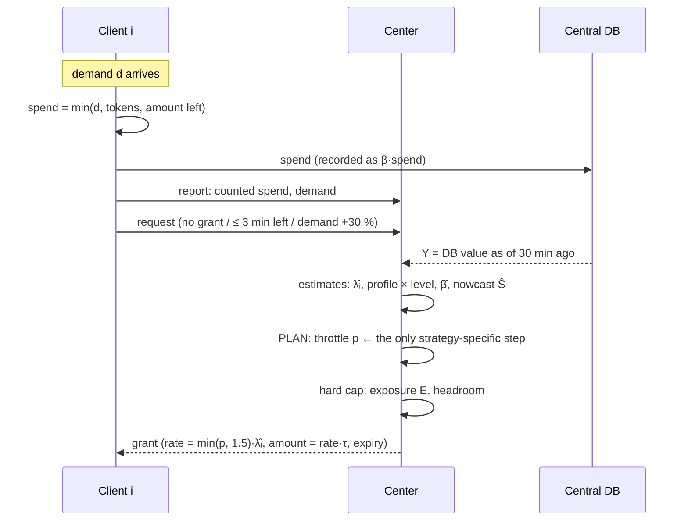
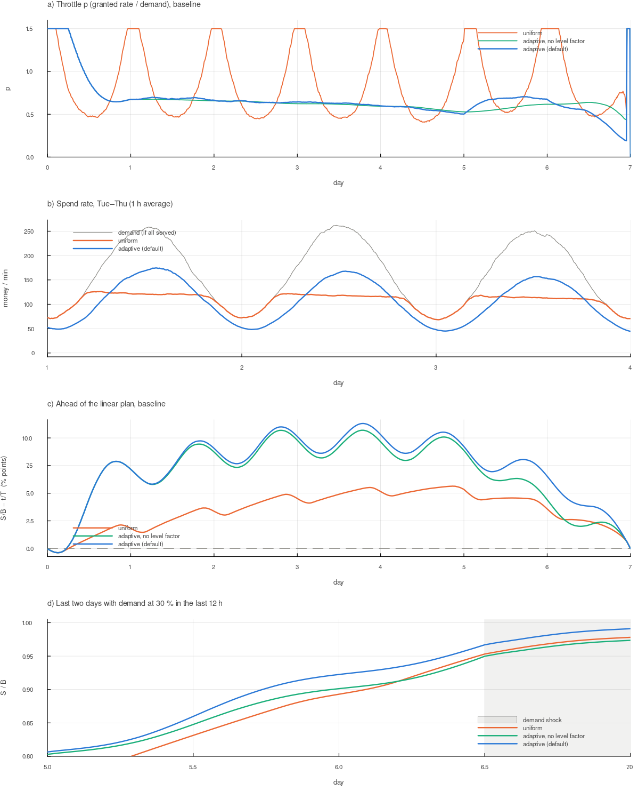

# Pacing strategies: how the clients and the center work

This document explains, step by step, what the clients and the center do under each pacing strategy, and how
the strategies differ in behaviour and results. The model, notation and full experiment tables are in
[MODEL.md](MODEL.md).

All strategies share the same machinery: grants, local pacing, the hard cap and the estimators. They differ
in **one step only**: how the center turns "remaining budget" into the **throttle p**, the fraction of
demand clients may serve. Everything else follows from p.

## 1. The shared cycle (every minute, every strategy)



### Client (identical in every strategy)

1. **Demand arrives.** $d$ is what the client could spend this minute. Demand it doesn't serve is lost.
2. **Track its own demand** with a 30-min EWMA ($\lambda_{own}$).
3. **Spend through a token bucket.** The bucket fills at the grant rate and holds at most 5 minutes' worth. The client spends $\min(d, \text{tokens}, \text{amount left})$, so it never spends a grant at once.
4. **On expiry,** stop. The unused amount is freed at the center.
5. **Partial return:** keep at most 2× the expected use until expiry and return the rest.
6. **Report** the counted spend and demand.
7. **Request a new grant** if:
   - it has none;
   - less than 3 min of time, or of money at the grant rate, is left;
   - its demand has risen more than 30 % above what the grant was sized for (re-grant).

The client does **not** know B, the strategy, or p. It only sees the rate in its grant. The strategy reaches the client only through that rate.

### Center (identical except for the PLAN step)

1. **Observe** the delayed DB value $Y$ and the reports.
2. **Estimate** per-client demand $\hat\lambda_i$, the daily profile and level, $\hat\beta$, and the nowcast $\hat S = Y + \hat\beta \cdot$ (reported spend in the last 30 min).
3. **PLAN:** compute the throttle $p$ (sections 2–4).
4. **Hard cap:** compute the exposure $E$ of open grants. A new grant may be at most $(B - Y - E)/\beta_{max}$.
5. **Issue grants:** rate $= \min(p, 1.5) \cdot \hat\lambda_i$, $\tau = \text{clamp}(0.01 (T-t), 5, 60)$ min, amount = rate · τ.

Common to all strategies: $R = B - \hat S$ (remaining budget), $T_{plan} = T - 1\text{ h}$ (finish buffer), haircut $h_c = 0.2$.

## 2. Uniform pacing

**Idea:** spend the remaining budget **at the same speed every minute**, regardless of the time of day.

```math
r^* = \frac{R}{(1-h_c)(T_{plan}-t)}, \qquad p = \frac{r^*}{\hat\beta \sum_i \hat\lambda_i}
```

**What the center does.** It needs no demand forecast at all, only the remaining budget and the remaining time. The target rate $r^*$ is nearly constant, and it is corrected minute by minute as $\hat S$ moves.

**What follows for $p$.** Demand varies about 4× over the day, but $r^*$ does not, so $p$ must swing **against** demand:

- at the midday peak there is plenty of demand → $p$ falls to about 0.45;
- at night demand is below $r^*$ → $p$ hits the 1.5 cap, and clients serve all their demand but still spend less than the target.

**What clients experience** (a median client, Wednesday):

| | noon | 3 am |
|---|---|---|
| client demand | ≈ 4.6 /min | ≈ 1.7 /min |
| throttle $p$ | ≈ 0.45 | 1.5 (cap) |
| grant rate | ≈ 2.1 /min | ≈ 2.5 /min (more than the demand) |
| grant amount (τ = 60 min) | ≈ 125 | ≈ 150, mostly unused |
| share of demand served | ≈ 45 % | 100 % |

At night clients hold grants larger than they can use. That reserves headroom for nothing, so more is returned and utilization is lower.

**Behaviour over the week.** Spend is flat at about $r^*$ during the day and limited by demand at night (§5, figure b). Each night the center falls behind its plan, and each day it catches up by throttling less. There is no protection when the period **ends** in a low-demand phase (a weekend night). Without a planning margin, the shortfall cannot be recovered: 97.6 % spent in the baseline.

**Strengths:** simple, needs no forecast, easy to explain ("same speed all the time").
**Weaknesses:** it fights the demand pattern; spending is concentrated wherever demand happens to fall below the target; it is weak at the end of the period and under late shocks.

## 3. Adaptive pacing without the level factor

**Idea:** spend **in proportion to demand**, so the budget and the expected demand run out together. The center learns a daily demand profile and plans against it.

```math
r^* = R \cdot \frac{\hat\Lambda_{now}}{(1-h_c)\hat\Lambda(t, T_{plan})}, \qquad
\hat\Lambda(t, T_{plan}) = \int_t^{T_{plan}} \text{profile}(s)\, ds, \qquad
p = \frac{R}{\hat\beta (1-h_c) \hat\Lambda(t, T_{plan})}
```

**What the center does in addition:**

- **Profile learning:** it averages total reported demand in 96 bins of 15 minutes. Each new day is blended 50/50 into the profile.
- **Remaining demand:** each minute it integrates the profile from now to $T_{plan}$. On day 1, bins that have not been seen yet use the long-run average demand.

**What follows for $p$.** $\hat\Lambda_{now}$ cancels out, so $p$ does **not** depend on the time of day: it is about 0.6–0.7 all week. The center does not chase demand; demand chases itself.

**What clients experience** (same median client, Wednesday):

| | noon | 3 am |
|---|---|---|
| client demand | ≈ 4.6 /min | ≈ 1.7 /min |
| throttle $p$ | ≈ 0.64 | ≈ 0.64 |
| grant rate | ≈ 2.9 /min | ≈ 1.1 /min |
| grant amount (τ = 60 min) | ≈ 175 | ≈ 64 |
| share of demand served | ≈ 62 % | ≈ 57 % |

Every client gets the same share of its demand at every hour. Grants are large when there is demand to use them and small when there is not.

**The weakness.** The profile is learned from the days already seen. The period starts on Monday, so by Friday the profile has learned only **weekdays**. On the weekend (demand −30 %) or during a late shock, the center still expects weekday demand. It believes plenty of demand is coming, so it keeps $p$ too low and falls behind exactly when there is no time left.

## 4. Adaptive pacing with the level factor (default, best)

**Idea:** as in section 3, but the forecast is **scaled by how today compares to the profile**.

```math
\text{level} \leftarrow \text{EWMA}_{4h}\left(\frac{\text{current total demand}}{\text{profile}(\text{now})}\right), \qquad
\hat\Lambda(t, T_{plan}) = \int_t^{T_{plan}} \text{level} \cdot \text{profile}(s)\, ds
```

**What the center does in addition:** it keeps one more EWMA, the ratio of actual demand to the profile. If Saturday runs at 70 % of a normal day, the level drops to about 0.7 within a few hours. The whole remaining forecast is then scaled down, so $p$ goes **up**, and the center spends more of the demand that is still there.

**What clients experience.** The same as in section 3 on weekdays. When demand falls below the forecast (weekend, shock), every client's grant rate rises within hours, because $p$ rises. With a late shock, $p$ goes to the 1.5 cap and clients serve all their demand.

**Why it is the best of the three:**

- Spend is proportional to demand, so it does not rely on finding demand in a specific hour.
- It corrects a **wrong forecast** within hours, without knowing *why* demand changed (weekly pattern, holiday, outage).
- It needs only one extra number, the level.

**What remains hard:** if demand drops late and for good, no strategy can recover the money that should already have been spent. Only the planning margin (haircut) helps then, because it spends earlier.

## 5. Side by side

### Same world, one run (seed 1)

All strategies see exactly the same demand realization. The center draws a fixed amount of random numbers per step, so the world's random stream is identical. Script: `scripts/compare_pacing.jl`.

| strategy | p median (Tue–Fri) | p 5–95 % (Tue–Fri) | served at peak 11–13 h | served at night 2–4 h | p median (weekend) | minutes at max rate | grants/min | done before T (h) |
|---|---|---|---|---|---|---|---|---|
| uniform | 0.70 | 0.45–1.50 | 45 % | 100 % | 0.73 | 1350 | 2.51 | 1.5 |
| adaptive, no level factor | 0.62 | 0.54–0.67 | 62 % | 56 % | 0.60 | 360 | 2.48 | 1.7 |
| **adaptive (default)** | 0.64 | 0.53–0.69 | 62 % | 57 % | 0.61 | 360 | 2.37 | 2.6 |

"Minutes at max rate" counts the time when $p \ge 1.5$, i.e. clients serve all their demand.

- For the adaptive strategies those 360 minutes are the first 6 h of day 1, while there is no profile yet.
- For uniform pacing they are spread over every night: about 22 h per week.



- **a)** Uniform $p$ swings every day between 0.45 and the 1.5 cap. Adaptive $p$ is nearly constant. At the weekend (day 5) the level factor raises $p$ (blue); without it, $p$ stays flat (green).
- **b)** Uniform spend is flat during the day and limited by demand at night. Adaptive spend follows the demand curve.
- **c)** Both adaptive variants run ahead of the linear plan, about 10 points mid-week. This is the haircut and day-1 learning; it is intentional. Uniform runs closer to linear.
- **d)** With demand at 30 % in the last 12 h, the default adaptive strategy enters the drop with more already spent and finishes at 99.1 %. The other two stop at about 97.5 %.

| strategy, last-12h shock 30 % (seed 1) | spend % of B | p median in the last 12 h |
|---|---|---|
| uniform | 97.81 | 1.50 |
| adaptive, no level factor | 97.36 | 1.30 |
| **adaptive (default)** | 99.10 | 1.50 |

### Monte Carlo (40 runs per cell, mean / worst % of B spent; from MODEL.md §6.A)

| strategy | baseline | demand ×1.15 | day-4 shock 20 % | last-12h shock 30 % | demand ×0.9 |
|---|---|---|---|---|---|
| uniform | 100.00 / 100.00 | 98.22 / 97.47 | 99.72 / 99.46 | 97.71 / 97.45 | 87.61 / 86.48 |
| adaptive, no level factor | 100.00 / 100.00 | 100.00 / 100.00 | 100.00 / 100.00 | 97.37 / 97.05 | 92.02 / 89.93 |
| **adaptive (default)** | 100.00 / 100.00 | 100.00 / 100.00 | 100.00 / 100.00 | 99.14 / 98.98 | 92.02 / 89.94 |
| uniform, no margin | 97.59 / 97.23 | 91.47 / 90.69 | 94.11 / 93.31 | 92.57 / 92.21 | 81.98 / 81.06 |
| adaptive, no margin | 100.00 / 100.00 | 97.74 / 97.22 | 98.56 / 97.98 | 95.82 / 95.60 | 89.21 / 87.96 |

No strategy ever exceeded $B$. Safety comes from the hard cap, which is the same for all strategies.

## 6. Modifiers that apply to any strategy

These change how aggressively a strategy plans, not its shape. Details are in MODEL.md §4.3 and §6.B/F.

| modifier | what it does to p | effect |
|---|---|---|
| finish buffer (1 h) | plans to finish 1 h before $T$; inside the buffer, $p = \infty$ (the cap stops spending) | absorbs end-of-period errors |
| forecast haircut (0.2) | divides by $(1-h_c)$, so $p$ is about 25 % higher | runs ahead; insurance against late demand drops; finishes 2–3 h early |
| nowcast vs raw $Y$ | plans with $\hat S$ instead of the 30-min-old $Y$ | with raw $Y$ the center always thinks it is behind, which acts as an accidental margin that grows with the delay |

## 7. Other pacing strategies (not implemented)

| strategy | how it works | pros | cons |
|---|---|---|---|
| **ASAP / greedy** | $p = \infty$: serve all demand until $B$ is reached | trivial; never underspends if demand suffices | budget gone early; no smooth delivery |
| **fixed schedule (dayparting)** | a predefined share of $B$ per hour or day | predictable for operators | needs a known pattern; cannot react to surprises |
| **target-curve tracking (PI/PID)** | target $S^*(t)$ from the learned profile; $p$ corrected by a PI controller on $S^* - \hat S$ | classic control; explicit tuning of reaction speed | the gains must be tuned against delay $D$ and noise; needs the nowcast (Smith predictor) for stability |
| **model predictive control (MPC)** | each minute, optimise $p$ over the rest of the period under forecast uncertainty, with a cost on underspend and on an idle tail | most principled; can include the asymmetric costs directly | needs a demand model with uncertainty; heavier computation |
| **value / priority pacing** | a different $p$ per client by value or priority | spends the budget where it is worth most | needs a value signal; fairness questions |
| **probabilistic throttling without grants** | each transaction is accepted with probability $p$ | no grant bookkeeping | needs a central decision per transaction; no hard cap without a reservation |

The adaptive strategy here is close to target-curve tracking with a very simple controller: re-planning from the remaining budget is proportional feedback with a gain that grows toward the end. MPC is the natural next step if the costs of underspend and of an early finish can be stated explicitly.

## 8. How to choose

- **Default:** adaptive with the level factor, finish buffer 1 h and haircut 0.2. It is best or tied in every tested scenario, and it treats clients the same way at every hour.
- **Uniform** only if no demand reports are available (so no profile can be learned), or if a constant spending speed is a business requirement. Then a planning margin is essential.
- **Without the level factor** only if the demand pattern is known to repeat exactly every day. It saves one EWMA and is never better.

## 9. Reproduce

```sh
julia scripts/compare_pacing.jl                  # per-strategy metrics, out/pacing_*.csv
julia --project=plots plots/plot_pacing.jl       # out/pacing.png
julia -t auto scripts/strategies.jl 40           # Monte Carlo tables (MODEL.md §6)
```
